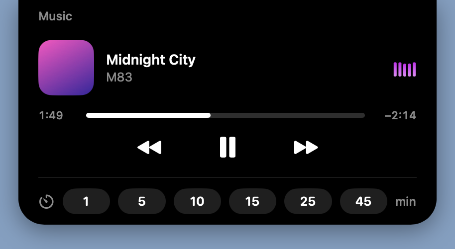
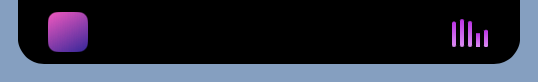
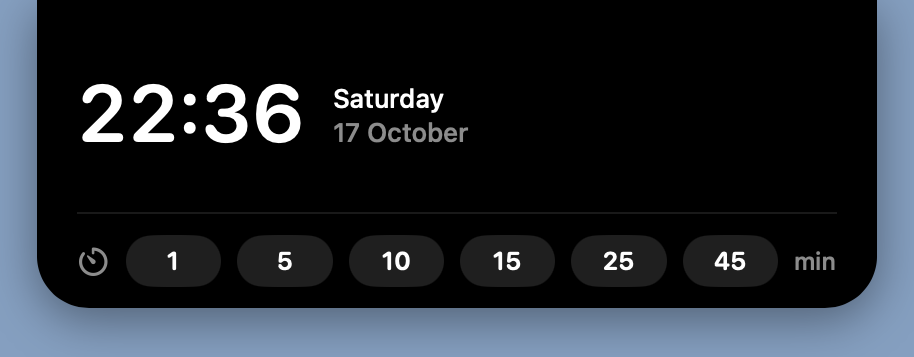
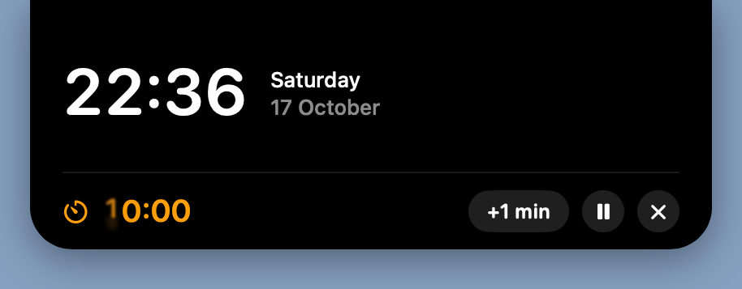
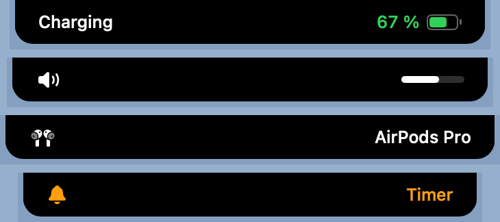

<div align="center">

# DynamicIsland

**Turns the MacBook notch into an iPhone-style dynamic island.**

Music, a timer, battery, volume and output devices — right around the camera cutout.
Native SwiftUI, documented system facilities only, no third-party dependencies.



</div>

---

## Features

- 🎵 **Music from several sources** — Music, Spotify, and the **browser (Safari: YouTube, YouTube Music, SoundCloud, etc.)**. The one that started playing most recently becomes active.
- 🎚 **Playback control** — play/pause, scrub, next/previous track right from the island.
- 📊 **A visualizer driven by the real sound** — the bars dance to the spectrum of the music that's playing (FFT via vDSP), with a gradient fill in the artwork's color.
- ⏱ **Timer** — quick-start for 1–45 minutes, with a sound and a pop-out alert when it finishes.
- 🔋 **Alerts** — charger plugged in, low battery (20/10/5 %), volume change, output-device change (headphones, AirPods, speaker, HDMI…).
- 🖱 **Expand on hover** or by clicking — a panel with the player, clock and timer.
- ⚙️ **Settings** — the menu bar icon or a right-click on the island: what to show, expand on hover, haptics, running in fullscreen, launch at login.

At rest the island blends into the notch and stays out of the way; it stretches only when there's something to show.

## Screenshots

<div align="center">

| Compact player | Clock | Timer |
|:---:|:---:|:---:|
|  |  |  |

**Alerts** (charging, volume, device, timer):



</div>

## Requirements

- A MacBook with a **notch** (Apple Silicon).
- **macOS 14** or newer.
- **Command Line Tools** to build (`xcode-select --install`). Full Xcode is not required.

## Build & run

```bash
git clone https://github.com/gdfaler/DynamicIsland.git
cd DynamicIsland
./build.sh
open DynamicIsland.app
```

`build.sh` compiles `Sources/*.swift` into `DynamicIsland.app`, draws the icon and signs the app.
So the app doesn't ask for permissions again on every rebuild, the script creates a persistent self-signed
certificate **once** in a separate keychain (`dynamicisland-signing`) and signs with it — this way the granted
permissions (Screen Recording, Automation) survive rebuilds.

The app lives in the menu bar (it takes no Dock icon). You can move it to `/Applications` — permissions are tied
to the signature, not the path, so they won't fall off.

## Permissions

The app works with documented facilities only and asks for the minimum — every prompt appears on its own, the
first time a feature needs it:

| Feature | Permission | Where to grant |
|---|---|---|
| Music / Spotify | Automation | a prompt appears on the first track |
| Music from the browser | Automation for Safari **+** `Develop → Allow JavaScript from Apple Events` | the prompt, plus Safari → Settings → Advanced → "Show features for web developers", then the Develop menu |
| Sound visualizer | Screen Recording (only the audio is used, video isn't read) | a prompt on the first playback; can be turned off in the menu |

If you don't use a feature, you don't need to grant its permission — everything else keeps working.

## How it works

macOS doesn't give third-party apps the system's locked-down "Now Playing", so the island gets by with
**documented facilities only**, without private APIs and without touching system processes:

- **Music and Spotify** — their own AppleScript interface (track, position, artwork, commands) plus the
  track-change notification (`com.apple.Music.playerInfo`, `com.spotify.client.PlaybackStateChanged`).
- **Safari / web** — the public `do JavaScript`: the island reads `navigator.mediaSession` and the
  `<video>/<audio>` tags straight from the page, and skips tracks with the site player's own buttons.
- **Visualizer** — system audio via **ScreenCaptureKit**, spectrum computed with **vDSP** (FFT), 5 bands
  (bass → treble) normalized by span so they don't stick at the maximum.
- **Battery/power** — IOKit Power Sources; **volume/devices** — CoreAudio; all notification-driven, no polling.

## Project layout

```
Sources/
  App.swift            entry point, menu bar menu, settings toggles
  IslandController.swift  the window over the notch, cursor tracking
  IslandModel.swift    the island's state and geometry
  IslandView.swift     the island shape and collapsed views
  ExpandedView.swift   the expanded panel: player, clock, timer
  NowPlaying.swift     the music-source aggregator
  Players.swift        sources: Music/Spotify (AppleScript) and Safari (do JavaScript)
  AudioMeter.swift     audio capture (ScreenCaptureKit) + spectrum (vDSP)
  Audio.swift          volume and output devices (CoreAudio)
  Power.swift          battery and power (IOKit)
  Countdown.swift      the timer
  Components.swift     equalizer, battery, artwork, etc.
  Theme.swift          the notch shape, colors, animations
  Snapshots.swift      state snapshots for layout checks (ISLAND_SNAPSHOT_DIR)
build.sh               build, icon, persistent signature
MakeIcon.swift         the app-icon generator
```

## Limitations

- Works only on a Mac with a notch; on displays without a cutout there's nowhere for the island to hide.
- The signature is self-signed (local) — the app isn't notarized; it's distributed as source for a self-build.
- "Now Playing" from apps without an AppleScript interface and outside Safari isn't visible to the island (a macOS limitation).

## License

[MIT](LICENSE)
