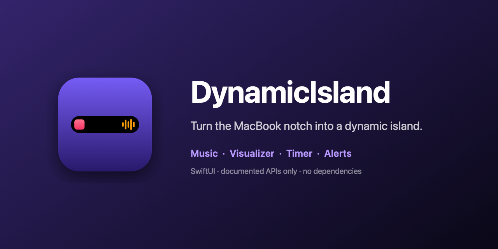
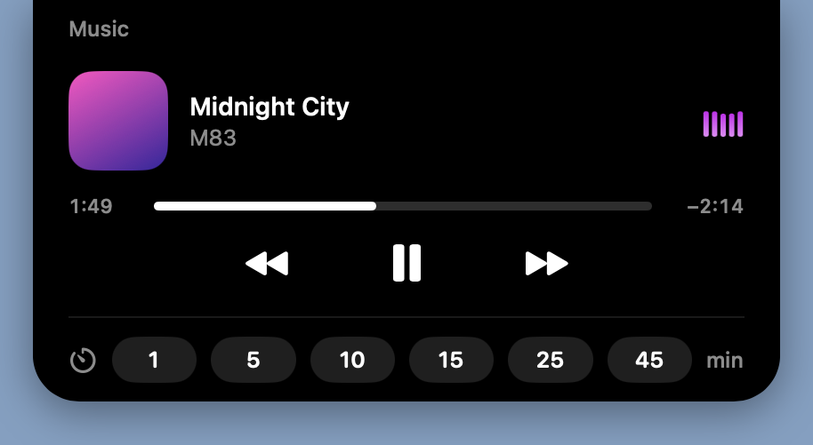
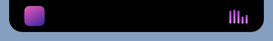
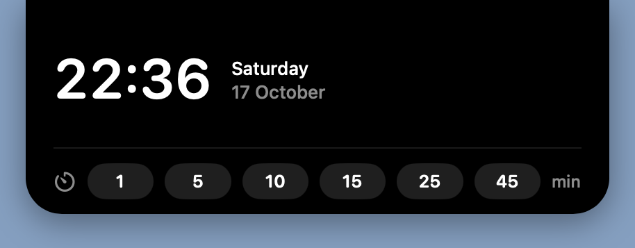
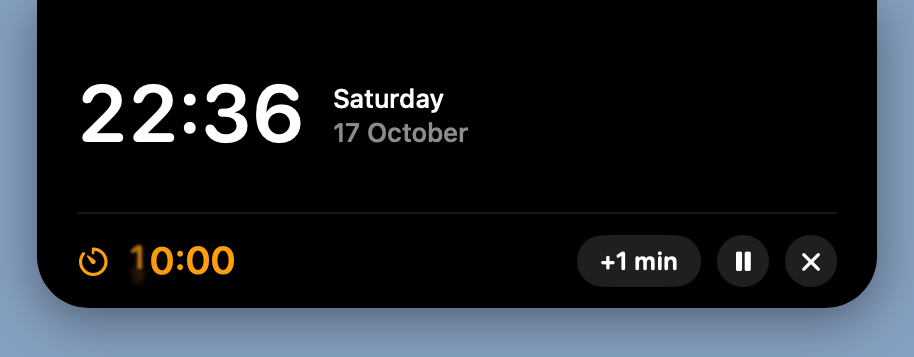
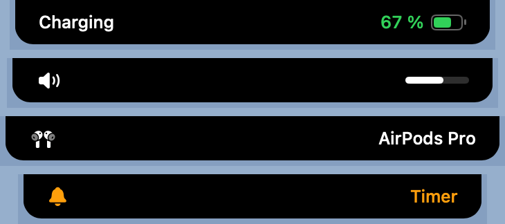

<div align="center">



# DynamicIsland

**Turns the MacBook notch into an iPhone-style dynamic island.**

Music, a timer, battery, volume and output devices — right around the camera cutout.
Native SwiftUI, documented system facilities by default (one clearly labelled experimental option aside), no third-party dependencies.



</div>

---

## Features

- 🎵 **Music from several sources** — Music, Spotify, and the **browser (Safari, Chrome, Brave, Edge, Arc: YouTube, YouTube Music, SoundCloud, etc.)**. The one that started playing most recently becomes active.
- 🎚 **Playback control** — play/pause, scrub, next/previous track right from the island.
- 📊 **A visualizer driven by the real sound** — the bars dance to the spectrum of the music that's playing (FFT via vDSP), the bars are cut out of the track's artwork blurred beyond recognition, so each cover gives its own colors.
- ⏱ **Timer** — quick-start for 1–45 minutes, with a sound and a pop-out alert when it finishes.
- 🔋 **Alerts** — charger plugged in, low battery (20/10/5 %), volume change, output-device change (headphones, AirPods, speaker, HDMI…).
- 🖱 **Expand on hover** or by clicking — a panel with the player, clock and timer.
- 🖥 **Several displays** — choose where the island lives: the notch display (automatic), following the cursor, on every display, or pinned to one. It measures each display's notch and fits itself to it.
- 🪟 **Works without a notch** — on displays without a cutout the island sits on a virtual notch at the top centre, scaled to the display: hidden until needed, always visible, or always visible with expand-on-click.
- 🌍 **Localized** — English and Russian.
- ⚙️ **Settings** — the menu bar icon or a right-click on the island: what to show, which display, the look without a notch, expand on hover, haptics, running in fullscreen, launch at login.

At rest the island blends into the notch and stays out of the way; it stretches only when there's something to show.

## Screenshots

<div align="center">

| Compact player | Clock | Timer |
|:---:|:---:|:---:|
|  |  |  |

**Alerts** (charging, volume, device, timer):



</div>

## Requirements

- An Apple Silicon Mac. A notch is not required: without one the island uses a virtual notch.
- **macOS 14** or newer.
- **Command Line Tools** to build (`xcode-select --install`). Full Xcode is not required.

## Install

- **Download** the `.dmg` or `.zip` from [Releases](https://github.com/gdfaler/DynamicIsland/releases), drag the app to
  Applications. It's self-signed and not notarized, so the first time: right-click → **Open**, or run
  `xattr -cr /Applications/DynamicIsland.app`.
- **Homebrew** (this repository is its own tap; needs a current Homebrew):
  ```bash
  brew tap gdfaler/dynamicisland https://github.com/gdfaler/DynamicIsland
  brew trust gdfaler/dynamicisland     # recent Homebrew asks you to trust third-party taps
  brew install --cask dynamicisland
  ```
  The cask also clears the quarantine flag, so no right-click → Open is needed.
- **From source**: see below.

The island tells you when a new version is out (a green arrow with the version; click it to open the release page).
That check is one request to the public GitHub Releases API every 12 hours; turn it off with *Check for updates
automatically* in the menu.

## Build & run

```bash
git clone https://github.com/gdfaler/DynamicIsland.git
cd DynamicIsland
./build.sh
open DynamicIsland.app
```

`build.sh` compiles `Sources/*.swift` into `DynamicIsland.app`, draws the icon and signs the app.
So the app doesn't ask for permissions again on every rebuild, the script creates a persistent self-signed
certificate **once** in a separate keychain (`dynamicisland-signing`) and signs with it — this way the granted
permissions (Screen Recording, Automation) survive rebuilds.

The app lives in the menu bar (it takes no Dock icon). You can move it to `/Applications` — permissions are tied
to the signature, not the path, so they won't fall off.

Prebuilt `.dmg`/`.zip` builds are on the Releases page (`./package.sh` makes them). The app isn't notarized:
on first launch right-click → Open, or run `xattr -cr /Applications/DynamicIsland.app`.

## Experimental: Now Playing from any app

Off by default (Settings → Content). macOS doesn't give third-party apps the system's "Now Playing", so by default the
island reads Music, Spotify and browsers through their own documented interfaces. The experimental option adds
**any other app** (VLC, Tidal, a podcast player…) through the private MediaRemote framework. Since macOS 15.4 only
Apple-signed processes may use it, so the app runs a small helper through `/usr/bin/perl` (Apple's own binary) and
reads its output; the code is in `Bridge/mrbridge.c` and `Sources/MediaRemoteSource.swift`. It can stop working after
a macOS update — when it does, turn it off; nothing else is affected.

## Permissions

The app works with documented facilities only and asks for the minimum — every prompt appears on its own, the
first time a feature needs it:

| Feature | Permission | Where to grant |
|---|---|---|
| Music / Spotify | Automation | a prompt appears on the first track |
| Music from the browser | Automation for the browser **+** Allow JavaScript from Apple Events | the prompt, plus Safari: Develop menu (Settings → Advanced → "Show features for web developers"); Chrome/Brave/Edge/Arc: View → Developer |
| Sound visualizer | Screen Recording (only the audio is used, video isn't read) | a prompt on the first playback; can be turned off in the menu |

If you don't use a feature, you don't need to grant its permission — everything else keeps working.

## How it works

macOS doesn't give third-party apps the system's locked-down "Now Playing", so the island gets by with
**documented facilities only**, without private APIs and without touching system processes:

- **Music and Spotify** — their own AppleScript interface (track, position, artwork, commands) plus the
  track-change notification (`com.apple.Music.playerInfo`, `com.spotify.client.PlaybackStateChanged`).
- **Safari / web** — the public `do JavaScript`: the island reads `navigator.mediaSession` and the
  `<video>/<audio>` tags straight from the page, and skips tracks with the site player's own buttons.
- **Visualizer** — system audio via **ScreenCaptureKit**, spectrum computed with **vDSP** (FFT), 5 bands
  (bass → treble) normalized by span so they don't stick at the maximum.
- **Battery/power** — IOKit Power Sources; **volume/devices** — CoreAudio; all notification-driven, no polling.

## Project layout

```
Sources/
  App.swift            entry point, menu bar menu, settings toggles
  IslandController.swift  an island window per display, display modes, cursor tracking
  Displays.swift       per-display notch measurement, identity and scaling
  IslandModel.swift    the island's state and geometry
  IslandView.swift     the island shape and collapsed views
  ExpandedView.swift   the expanded panel: player, clock, timer
  NowPlaying.swift     the music-source aggregator
  Players.swift        sources: Music/Spotify (AppleScript) and Safari/Chromium browsers (JavaScript hook)
  AudioMeter.swift     audio capture (ScreenCaptureKit) + spectrum (vDSP)
  Audio.swift          volume and output devices (CoreAudio)
  Power.swift          battery and power (IOKit)
  Countdown.swift      the timer
  Components.swift     equalizer (bars masked by the blurred artwork), battery, artwork, etc.
  Backdrop.swift       the artwork blurred for the visualizer
  Localization.swift   L() — string lookup
  Theme.swift          the notch shape, colors, animations
  Snapshots.swift      state snapshots for layout checks (ISLAND_SNAPSHOT_DIR)
Resources/             localizations (<lang>.lproj/Localizable.strings)
build.sh               build, icon, persistent signature
package.sh             builds dist/*.dmg and *.zip for a release
MakeIcon.swift         the app-icon generator
```

## Limitations

- On displays without a cutout the island is a virtual one (a black pill over the menu bar that shows only when active or hovered).
- The signature is self-signed (local) — the app isn't notarized; it's distributed as source for a self-build.
- "Now Playing" from apps without an AppleScript interface and outside Safari isn't visible to the island (a macOS limitation).

## Contributing

Bug reports, feature ideas, translations and pull requests are welcome — see [CONTRIBUTING.md](CONTRIBUTING.md).
Security issues: [SECURITY.md](SECURITY.md).

## License

[MIT](LICENSE)
